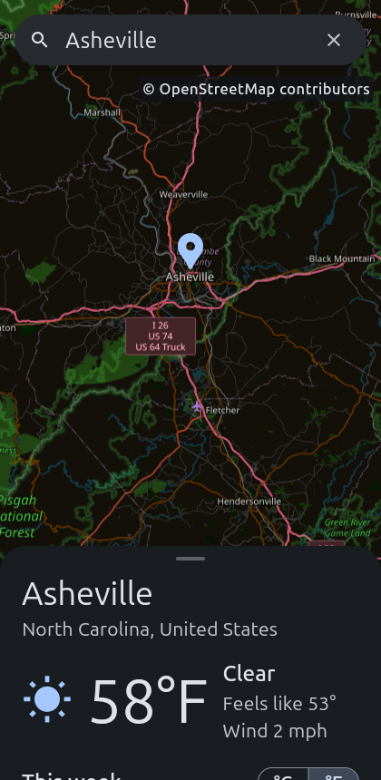

# flutter-weather

A weather app in Flutter. One screen: a map with a Material 3 search bar over
it. Search for a place, or press and hold on the map, and the forecast for the
week appears.

| Wide window | Phone |
| --- | --- |
|  |  |

It is one of four builds of the same app, alongside
[kmp-weather](https://github.com/calemccammon/kmp-weather),
[react-native-weather](https://github.com/calemccammon/react-native-weather) and
[maui-weather](https://github.com/calemccammon/maui-weather),
to compare the frameworks.

## What it does

- **Search** with results as you type, after a short pause; an answer to an
  older query never replaces a newer one.
- **Pick a point** by pressing and holding on the map.
- **Forecast**: current conditions, then seven days with the chance of
  precipitation and each day's range drawn against the week's.
- **Adapts to the window**: a draggable bottom sheet on a phone, a side panel
  from 840 px wide. The map keeps the chosen place clear of both.
- **Celsius or Fahrenheit**, chosen on the forecast and remembered between
  launches. Until you choose, it follows the device's region.
- **Light and dark** themes from one seed colour, following the system.
- **Accessible**: each forecast block is read as one sentence by a screen
  reader, and the layout holds at three times the default text size.
- **Says what went wrong**: a timeout, no connection and a refused request
  each have their own message and a way to try again.

## Architecture

Clean Architecture in three layers. Dependencies point inward only: `data`
and `ui` import `domain`, and `domain` imports neither.

| Path | What it holds |
| --- | --- |
| `lib/domain` | The app's own types (`Place`, `Forecast`, `WeatherCondition`, `Units`), the repository interfaces (`WeatherRepository` with its failure kinds, `SettingsRepository`), and the use cases (`SearchPlaces`, `GetForecast`, `GetUnits`, `SetUnits`) that hold the rules. Pure Dart. |
| `lib/data` | Open-Meteo: the wire-shaped models (`*_dto.dart`), their translation into domain types, and the repository implementation. Settings are kept with `shared_preferences`. |
| `lib/l10n` | Every string the user sees, in `app_en.arb` (Flutter's counterpart to Android's `strings.xml`). `flutter gen-l10n` turns it into the typed `AppLocalizations` class on `flutter pub get` and on each build. |
| `lib/ui` | `core` has the theme, its design tokens and the mapping from domain values to wording and icons. `home` has `models` (what the screen shows, already worded and rounded), `view_models` (call use cases and produce those models) and `widgets` (draw them, and import nothing from the domain). |
| `lib/di` | The one file that says which implementation stands behind each domain interface. |
| `test` | Mirrors `lib`, with shared fakes in `test/support`. |

Each layer has its own model of the same thing, and a translation between
them:

| | Data | Domain | UI |
| --- | --- | --- | --- |
| Type | `ForecastDto` | `Forecast` | `ForecastUiModel` |
| A day's high | `temperature_2m_max[1] = 64.3` | `high: 64.3` | `high: "64°"`, `barEnd: 0.75` |
| Conditions | `weather_code: 3` | `WeatherCondition.overcast` | an icon and `"Overcast"` |
| A failure | HTTP 400, a timeout | `WeatherFailure.rejected` | `l10n.failureRejected`: "The weather service refused the request." |

State is held by two Riverpod `Notifier` view models, `HomeViewModel` and
`SearchViewModel`, each exposing one sealed state type.

## Running

Flutter 3.50.0 (stable). Targets: Android, Linux desktop, web, iOS.

```sh
flutter pub get
flutter run            # pick the emulator or a connected phone
flutter run -d linux   # desktop window
flutter run -d chrome  # web; needs CHROME_EXECUTABLE set to a Chromium browser
```

iOS builds need a Mac and have not been run.

## Checks

```sh
flutter analyze        # rules in analysis_options.yaml; any finding fails CI
dart format .          # CI checks formatting too
flutter test
```

`.github/workflows/ci.yml` runs these on pushes to `main` and on pull
requests, then builds a debug APK, a web build and a Linux desktop bundle,
each uploaded as a workflow artifact.

`.github/workflows/pages.yml` builds the web app and publishes it to
`https://calemccammon.github.io/flutter-weather/`. It runs only when started
by hand from the Actions tab, and needs the repository to be public.

## Data and credits

- Place search and forecasts: [Open-Meteo](https://open-meteo.com/) (no key;
  free for non-commercial use; CC BY 4.0).
- Map: © [OpenStreetMap](https://www.openstreetmap.org/copyright)
  contributors, drawn with [`flutter_map`](https://pub.dev/packages/flutter_map).

## Known limits

- **Map tiles** come from OpenStreetMap's own servers, which are for
  development and light use only
  ([tile usage policy](https://operations.osmfoundation.org/policies/tiles/)).
  A published build needs a tile provider of its own.
- **English only.** The wording is all in `lib/l10n/app_en.arb` and weekday
  names follow the app's language, so a second language is one more `.arb`
  file; none has been written. A point picked off the map is still named in
  one notation ("35.60°N, 82.55°W").
- **Places are not saved**: the chosen place is forgotten when the app
  closes. Only the choice of units is kept.
